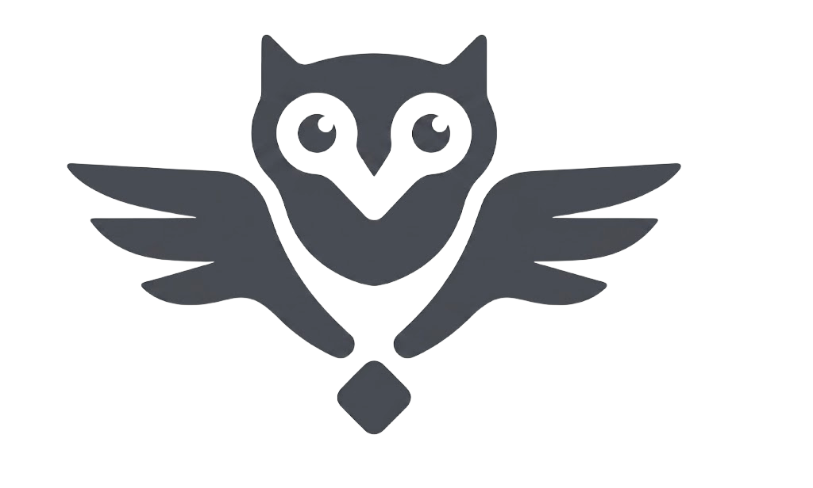
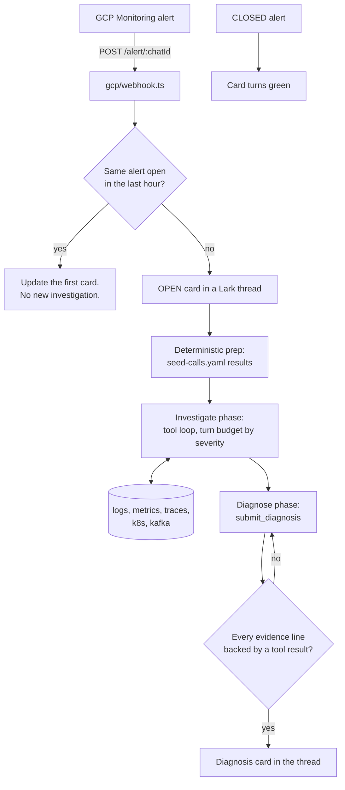
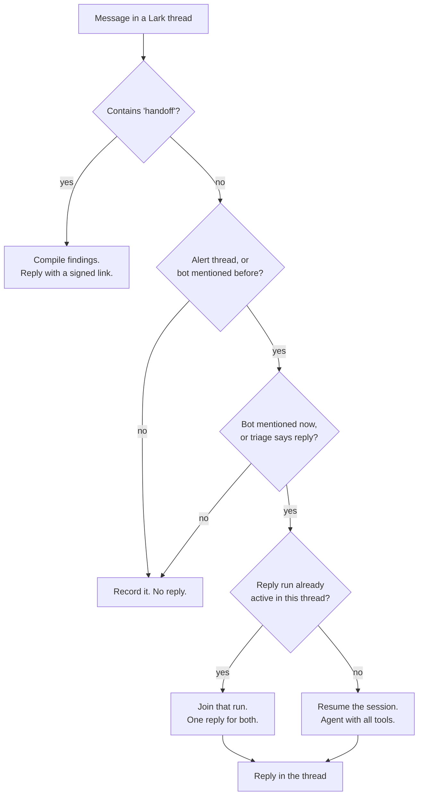

  <picture>
    <source media="(prefers-color-scheme: dark)" srcset=".github/assets/logo-dark.png">
    <source media="(prefers-color-scheme: light)" srcset=".github/assets/logo-light.png">
    
  </picture>

<h1 align="center">OpsRemedy</h1>

> **Personal project, limited support.** Built for my own workflow. Issues and PRs are welcome, but I make no commitment to respond, fix, or maintain.

OpsRemedy is a Lark bot that investigates GCP Monitoring alerts. It posts an alert card, has Claude check logs, metrics, traces, Kubernetes and Kafka, and then posts a root cause in the alert thread. Engineers ask follow-up questions in that thread.

The agent is read-only. No agent tool writes to your cluster or your cloud.

> **Credits**
>
> - Idea inspired by [Tracer-Cloud/opensre](https://github.com/Tracer-Cloud/opensre).
> - Agent runtime: [`earendil-works/pi`](https://github.com/earendil-works/pi) (`pi-ai`, `pi-durable`).

## Alert flow

`gcp/incident.ts:alertKey` decides whether two alerts are the same one. The grounding check is `tools/evidence.ts` plus `tools/grounding.ts`.

## Thread flow

The code is in `lark/handler.ts`, `triage.ts` and `harness/reply.ts`. The handoff doc is for a local dev agent, and text after `handoff` sets its focus.

## Tools the agent can call

| Tools                                                                                          | File in `src/tools/`   |
| ---------------------------------------------------------------------------------------------- | ---------------------- |
| `gcp_logging_query`                                                                            | `gcp_logging.ts`       |
| `prom_*`, `promql_instant`, `promql_range`, `promql_movers`                                    | `prom.ts`, `movers.ts` |
| `jaeger_get_trace` (lookup by trace id only)                                                   | `jaeger.ts`            |
| `kafka_list_groups`, `kafka_describe_group`, `kafka_list_topics`, `kafka_describe_topic`       | `kafka.ts`             |
| `k8s_get_pods`, `k8s_pod_logs`, `k8s_get_events`, `k8s_get_deployments`, `k8s_rollout_history` | `kubernetes.ts`        |
| `submit_diagnosis` (ends the run)                                                              | `registry.ts`          |

## Run it

1. Install the tools with `mise install`, the dependencies with `bun install`, and the gitleaks commit hook with `prek install`.
2. Copy `.env.example` to `.env` and fill in the Lark app, the webhook token and the session secret.
3. Replace every example value in `config.yaml`. `systemContext` describes your request path and namespaces to the agent.
4. Start the server with `bun run dev`.
5. Point a GCP Monitoring webhook channel at `https://<publicBaseUrl>/alert/<lark-chat-id>?token=<OPSREMEDY_WEBHOOK_TOKEN>`.

`seed-calls.yaml` maps an alert name pattern to tool calls that run before the first agent turn. The Anthropic OAuth rotation runbook is [`auth.md`](./auth.md).

## State

Each Lark thread has one session with its transcript and alert metadata. Sessions and a KV store sit in SQLite at `config.yaml:session.dbPath`. Sessions and incident rows expire after `session.ttlSeconds` (180 days by default). Alert groups expire after the flap window (1 hour), and signed links expire after 1 week.

## Caveats

- The agent reads whatever Kubernetes context and GCP project the pod can reach, and that can be production. Logs and pod state flow to the LLM.
- `utils/token-refresh.ts` patches the bot's own token Secret. It is the only cluster write, and no agent tool can call it.

See [`AGENTS.md`](./AGENTS.md) for development conventions.

## References

- [`googleapis/gcloud-mcp`](https://github.com/googleapis/gcloud-mcp): tool-design reference.
- [`k8sgpt-ai/k8sgpt`](https://github.com/k8sgpt-ai/k8sgpt): deterministic k8s analyzer reference.
- [`pab1it0/prometheus-mcp-server`](https://github.com/pab1it0/prometheus-mcp-server): Prometheus discovery-tool reference.
